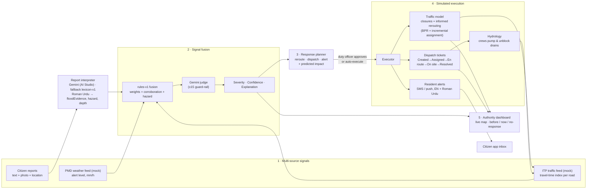

# Nikaasi — Architecture, Roles & Severity Rule (Checkpoints 1–2)

## User roles
| Role | Screen | Can do |
|---|---|---|
| **Citizen** | `citizen.html` (mobile-first, no login) | Report flooding (sector / map pin / GPS, free text in English or Roman Urdu, optional photo), see the live status of their sector, receive warnings and all-clear alerts |
| **Municipal / Traffic Authority admin** (CDA, ITP, Rescue 1122 duty officer) | `authority.html` (PIN, demo `1122`) | See live zone severity, incidents, reasoning trails; approve and execute AI response plans; watch tickets, closures and alerts; compare before/after; inject feed values for drills |
| *External systems (mocked)* | `GET /api/feeds/weather`, `GET /api/feeds/traffic` | PMD rainfall alerts; ITP / navigation-probe congestion |

## Data flow



The loop is closed: execution changes the simulated world (roads close, water drains). The world then changes the traffic feed, and the fusion engine sees that. So the dashboard shows severity **falling because of the response**, not because a timer ran out.

A draw.io version of this diagram is in [`architecture.drawio`](architecture.drawio). Open it at app.diagrams.net → File → Open.

## Components (code map)
| Module | Responsibility |
|---|---|
| `src/config.js` | Schematic world: 12 sectors (F/G/H × 11/10/9/8), 79 roads, G-10 underpass, depots, resident registry |
| `src/scenario.js` | "G-10 monsoon evening" script (storm + bot reports) |
| `src/nlp.js` | Offline report interpreter (English / Roman Urdu / Urdu cues, negation, intensity) |
| `src/gemini.js` | Google AI Studio Gemini adapter: report triage (text + photo) and incident judge, JSON mode, timeout + fallback |
| `src/fusion.js` | **Severity rule** (below) |
| `src/planner.js` | Builds actions from what is *observable* (never the hidden ground truth), picks nearest depot by live travel time, predicts impact |
| `src/traffic.js` | BPR volume-delay, 4-step incremental assignment, flooded capacity, informed vs uninformed drivers, exposure metrics |
| `src/engine.js` | Clock, feeds, hydrology, incident lifecycle, execution, tickets, alerts, counterfactual "no response" world |
| `server.js` | Zero-dependency HTTP + Server-Sent Events API |
| `public/` | Landing, citizen app, authority dashboard, shared SVG map renderer |

## Severity-judgment rule (rules-v1)

Each sector is evaluated every simulated minute.

**Citizen signal C ∈ [0,1]**
- Each report gets `floodEvidence` (0–1) from Gemini or the lexicon.
- Weight `w = evidence × recency × photoBonus`. Recency fades linearly to 40 % over **30 min**, and a photo adds ×1.15.
- One vote per reporter, so the same person reporting five times counts once.
- `C = 1 − e^(−Σw / 2)`. Diminishing returns: 1 strong report ≈ 0.39, 4 ≈ 0.86.

**Weather signal W ∈ [0,1]**
- `W = 0.6 × alert + 0.4 × min(1, rain/50 mm·h⁻¹)` with alert none 0, yellow .35, orange .65, red .9.

**Traffic signal T ∈ [0,1]**
- Recency-weighted peak travel-time index in the last **20 min**, divided by that sector's normal: `T = clamp((spike − 1)/1.5)`.
- If the spike is likely caused by *our own diversion* or by a bigger flood next door, T is discounted ×0.4 and the explanation says so.

**Score**
```
score = 100 × (0.45·C + 0.25·W + 0.30·T)
      + 15 if all three signals ≥ 0.4  (or +8 if two)     ← corroboration
      + 10 if a report says a person is at risk (and C ≥ 0.3)
```
| Score | Severity | Automatic plan |
|---|---|---|
| < 30 | **Watch** | none, keep watching |
| 30–54 | **Moderate** | ITP advisory, drain-team inspection (P3), alert sector residents |
| 55–74 | **High** | close flooded segments + reroute, drain team with pump (P2), alert sector + neighbours |
| ≥ 75 | **Critical** | as High at P1, plus Rescue 1122 if people are at risk or vehicles are stranded |

**Confidence** is the number of independent signals ≥ 0.3: 1 → Low, 2 → Medium, 3 → High (shown with a % that also rises with distinct reporters and a rising traffic trend).

**Why this design?** A citizen report alone can never go past *Watch*. The maximum is 45 points and there is no corroboration bonus, so a prank or panic post can't send a crew out. Weather + traffic without anyone reporting can reach *Moderate/High* with *Medium* confidence, which catches floods in areas where nobody posts. All three together give *High* confidence.

**Gemini's role.** When `GEMINI_API_KEY` is set, Gemini (1) interprets each report, including the photo, and (2) re-judges the incident from the same structured signals. The final score is the average of Gemini and rules-v1, **clamped to ±15 of the rules score**. The explanation is Gemini's. Both numbers appear on the dashboard, so the AI can't silently override the rule.

**Explanation example (generated):**
> High confidence: 5 citizen reports + active red rainfall alert (61 mm/h) + traffic spike 9.7× baseline (peak 1 min ago) in G-10 within the last 20–30 minutes. A report indicates a person may be at risk.

## Simulation model in one paragraph
Water depth per sector is hidden ground truth: `depth += rain/60 × runoff × 4 − (drain + crewPumping)`. G-10 has a half-blocked nullah, and its underpass pools water at 2.2× the sector depth. Flooded roads lose capacity (`1 − depth/45`) and stall cars above 35 cm. Uninformed drivers keep their usual routes and drive into water. After execution, closed segments are removed and alerted residents route around the flood or stay home (−70 % trips to/from a flooded sector). Drain crews travel along the live road network (ETA from Dijkstra), pump 5 cm/min on site and unblock the inlets. A second "no response" world runs in parallel from the moment of execution. The dashboard compares *at decision* / *now* / *no response*.

## API
| Method & path | Who | Purpose |
|---|---|---|
| `GET /api/config` | all | world geometry, AI status |
| `GET /api/stream?pin=` | all | Server-Sent Events state stream (full state only with PIN) |
| `GET /api/state` | all / PIN | snapshot |
| `POST /api/reports` | citizen | `{sector \| lat,lng \| x,y, text, photo?, name?, reporterId}` |
| `GET /api/alerts?sector=` | citizen | broadcasts for a sector |
| `GET /api/feeds/weather`, `/api/feeds/traffic` | all | the mock external feeds |
| `POST /api/incidents/:id/execute` | PIN | approve and execute the plan |
| `POST /api/incidents/:id/reassess` | PIN | force a Gemini re-judgment |
| `POST /api/scenario` | PIN | `play \| pause \| resume \| step \| reset \| speed` |
| `POST /api/weather` | PIN | manual weather override (drills) |
| `POST /api/settings` | PIN | `{autoExecute}` |
